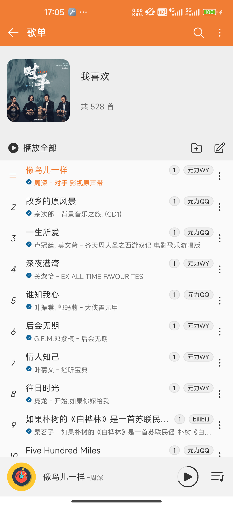
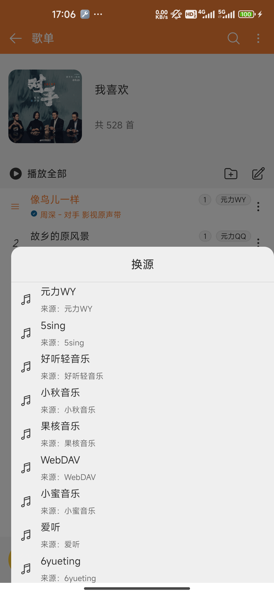
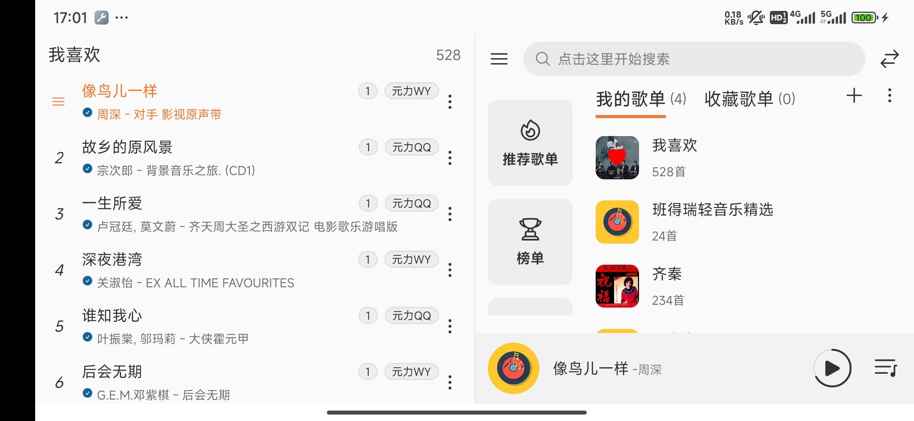
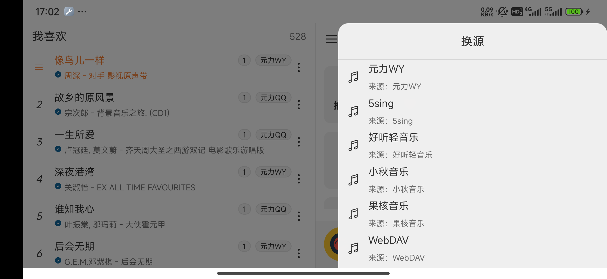
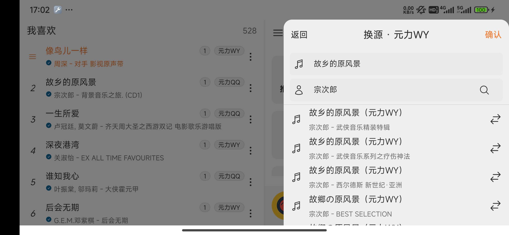
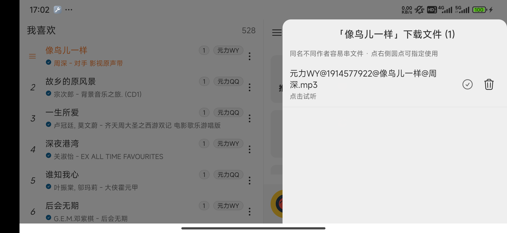

# MusicFree · 个人定制版

基于 [maotoumao/MusicFree](https://github.com/maotoumao/MusicFree)（`0.6.3-beta.1`，dev 分支）二次开发的个人自用版本。

本仓库在保留原版全部能力的基础上，重点增强了 **横屏分屏体验、本地下载文件管理、插件换源、WebDAV 歌曲备份** 四块。

- 原版说明（含插件开发文档、下载地址、Q&A）：[readme-upstream.md](./readme-upstream.md)
- 上游项目：<https://github.com/maotoumao/MusicFree>
- 遵循协议：**AGPL 3.0**（详见 [LICENSE](./LICENSE)）

> [!IMPORTANT]
> 本仓库不含任何音源。所有搜索、播放能力均来自外部**插件**，与本项目无关。请自行鉴别插件安全性，合法合规使用。

---

## 技术栈

| 层 | 选型 |
|---|---|
| 框架 | React Native **0.76.5** + Expo **^52** |
| 语言 | TypeScript |
| 列表 | `@shopify/flash-list` 1.7.1 |
| 播放 | `react-native-track-player` ^4.1.1 |
| 文件 | `react-native-fs` ^2.20.0 |
| 备份 | `webdav` ^5.7.0 |
| 包名 | `fun.upup.musicfree` |
| 版本 | `0.6.3-beta.1` |

---

## 新增与增强功能

### 1. 横屏分屏双栏

横屏（平板 / 手机横放）下首页自动切成左右两栏：

```
┌──────────────┬──────────────┐
│  首页栏       │  歌单栏       │
│  NavBar      │  歌单标题     │
│  首页内容      │  歌曲列表     │
│  MusicBar    │              │
└──────────────┴──────────────┘
```

- **左右可对调**：NavBar 上的 `arrows-left-right` 按钮一键切换「歌单在左 / 歌单在右」，竖屏不显示该按钮。状态持久化到 `app.splitPlaylistOnLeft`。
- **启动恢复**：自动打开上次浏览的歌单（`app.lastSplitSheetId`，默认「我喜欢」），并用 `scrollToOffset` 定位到当前播放项（O(1)，大歌单不卡顿）。
- **实现要点**：切换左右用的是 `flexDirection: row-reverse` 而不是交换子树——交换子树会让整树 remount，丢失两个列表的滚动位置。

关键文件：`src/pages/home/index.tsx`、`src/pages/home/splitContext.tsx`、`src/pages/home/components/sheetSplitView.tsx`

### 2. 长按歌单标题回到列表顶部

横屏歌单栏顶部的歌单名**长按 350ms**，列表平滑滚回第一条。标题热区撑满整个标题栏（`height: 100%`），不必精准点中文字。

### 3. 正在播放高亮 + 切歌自动跟随

- 正在播放的那一行，序号列替换为**动态条形图标**（`bars-3`），比只改文字颜色更醒目。
- 切歌时列表自动把目标行滚到可视区中部。
- 三处细节避免打扰用户：已完整可见则**不滚**、用户正在拖动列表时**不打断**、首次渲染不管（启动定位另有逻辑）。

### 4. 插件源标签点击换源

歌曲行右侧的「插件源」标签（如 `元力WY`、`网易音乐`）**点一下直接打开换源面板**，不会误触播放。

- 标签用底层 responder（`onStartShouldSetResponder` + `onResponderRelease`）接管触摸，比内层 `TouchableOpacity` 稳定——外层是 `TouchableHighlight` 时会抢事件。
- 附带 `hitSlop` 扩大点击热区。
- 换源面板自动按当前歌名搜索：选插件 → 自动搜索 → 结果列表 → 点一首即替换歌单内该歌曲（或直接播放）。
- 键盘弹起时点放大镜搜索会**自动收起键盘**，保证结果列表可见（`Keyboard.dismiss()`）。

关键文件：`src/components/mediaItem/titleAndTag.tsx`、`src/components/panels/types/switchSource.tsx`

### 5. 下载文件数字角标 + 文件面板

- 歌曲行源标签左侧显示一个**数字角标** = 该首歌在下载目录中匹配到的文件个数。
- 点击角标 → 弹出**下载文件面板**：列出全部同名文件，可试听 / 删除 / 指定。
- 同时兼容两种下载器命名规则：
  - 子目录式：`/Download/music/xxx.mp3`
  - 前缀式（旧版）：`/Download/music源@id@歌名@作者.mp3`
- 匹配宽严分级：角标与面板用 `loose` 模式（含完整歌名即可），「已下载」标记保持严格匹配，避免误标。

关键文件：`src/utils/mediaUtils.ts`、`src/components/panels/types/downloadFiles.tsx`

### 6. 指定使用某个下载文件（解决同名串文件）

**场景**：同名不同作者的歌（如「故乡的原风景」有多个版本），自动匹配容易播错文件。

**做法**：下载文件面板每行右侧有「指定使用」圆形按钮，点一下即锁定该文件。

- 指定后，播放时**优先**使用该文件（`getLocalPathWithFallback` 第 0 步），不再走自动匹配。
- 当前生效项显示为实心橙色圆点 + 「当前使用」文案，顶部提示行回显文件名。
- 指定关系存 MMKV（键 = `歌名@作者`），重启有效；文件被删会自动清理该记录并回退到自动匹配。
- 「已下载」勾选状态跟随指定关系变化。

关键文件：`src/utils/songFileOverride.ts`

### 7. WebDAV 歌曲备份与恢复

侧边栏设置新增独立子菜单「**歌曲备份与恢复**」，只做两件事：

| 功能 | 行为 |
|---|---|
| 备份歌曲到 WebDAV | 只上传远端**不存在**的文件 |
| 从 WebDAV 恢复 | 只下载本地**不存在**的文件（同名但大小不一致会重下覆盖） |

对比口径是**磁盘上的完整文件名精确相等**，不做前缀剥离或模糊匹配。

- **并发**：3 路并发池，可随时取消。
- **进度**：文件数进度条（绿）+ 字节进度条（蓝）+ 实时速度 `↑/↓ x.xx MB/s` + `已传输 X / Y`。速度按 3 秒滑动窗口计算，无增量自动衰减到 0。
- **取消要干净**：下载用 `RNFS.stopDownload` + 删除半成品（含原生缓冲区延迟回写）；上传用 `xhr.abort()`，在途任务立即结束。
- **大文件不进 JS 堆**：上传走 `XMLHttpRequest.send({ base64 })`（RN 原生层识别，二进制安全）；下载走 `RNFS.downloadFile` 原生流式落盘。

关键文件：`src/core/songBackup.ts`、`src/pages/setting/settingTypes/songBackupSetting.tsx`、`src/components/dialogs/components/songBackupProgressDialog.tsx`

### 8. 播放时自动下载

播放非本地文件时自动把音源缓存到下载目录，下次播放直接走本地。

### 9. 界面细节

- **歌曲行更紧凑**：行高 `rpx(120)` → `rpx(104)`，标题副标题间距 `rpx(16)` → `rpx(10)`，横屏一屏从 5 行变 6 行。
- **修复面板内列表无法手指滚动**：原 `PanelBase` 默认走 `KeyboardAvoidingView` 的 `position` 模式，它渲染的外层容器**高度为 0**，面板靠绝对定位向上溢出——这种结构下面板内 `FlatList` 的原生滚动手势完全失效（能画、能点、代码能滚，唯独手指拖不动）。改为单层绝对定位全屏容器 + `pointerEvents="box-none"`，滚动恢复正常，点面板外空白仍可关闭。

关键文件：`src/components/panels/base/panelBase.tsx`

---

## 界面截图

真实运行画面，浅色主题，截图设备为小米 10 Pro（2340×1080）。

### 竖屏

**首页**：搜索栏、四个快捷入口（推荐歌单 / 榜单 / 播放历史 / 本地音乐）、我的歌单、底部播放条。


**歌单页**：正在播放的那一行用动态条形图标标记、标题变主题色；每行右侧依次是**下载文件数角标**、**插件源标签**、更多操作。



**换源面板**：点源标签即可唤起，面板里是可用插件列表，选完自动按当前歌名搜索。



**下载文件面板**：点数字角标打开，右侧圆点即「指定使用」，锁定播放哪个文件。


### 横屏 · 分屏双栏

左栏是当前歌单（示例「我喜欢」，528 首），右栏是首页。可以看到：

- 正在播放的「像鸟儿一样」行首是**动态条形图标**、标题变为主题色（不是单纯改文字颜色）
- 每行源标签（`元力WY` / `元力QQ`）**左侧的数字**是该歌在下载目录中匹配到的文件数
- 行尾 `⋮` 是更多操作入口



#### 换源：点一下源标签就到

点歌曲行的源标签（示例点为「元力QQ」）直接唤起换源面板，先选插件：



选完插件会**自动按当前歌名搜索**，右侧箭头图标即替换为该结果：



#### 下载文件面板

点数字角标打开该歌曲在下载目录里的全部文件；右侧圆点可「指定使用」哪一个（解决同名不同作者串文件）：



---

## 构建

### 环境要求

| 组件 | 版本 |
|---|---|
| JDK | 17 |
| Node | ≥ 20（本项目验证于 22.x） |
| Android SDK | compileSdk / targetSdk 见 `android/app/build.gradle`，build-tools 35.0.0 |
| Gradle | 8.10.2（wrapper 内置） |
| 内存 | 建议 ≥ 16 GB |

### 步骤

```bash
# 1. 安装依赖（无 .git 的副本必须加 HUSKY=0，否则 prepare 阶段报错）
HUSKY=0 npm install

# 2. 配置签名
#   在 android/keystore.properties 里填（该文件已 gitignore，不会入库）
#   storeFile=musicfree-release.keystore
#   storePassword=***
#   keyAlias=***
#   keyPassword=***

# 3. 构建（在 android 目录下）
./gradlew assembleRelease
```

产物：`android/app/build/outputs/apk/release/`

| 文件 | 说明 |
|---|---|
| `app-arm64-v8a-release.apk` | 主流机型（约 19 MB） |
| `app-universal-release.apk` | 全 ABI 兜底（约 34 MB） |

> [!TIP]
> **只编 arm64 提速**：临时把 `android/app/build.gradle` 的 `splits.abi.include` 改成只留 `"arm64-v8a"`，构建快一大截。**发布前记得改回全 ABI**。
>
> **改过 splits 后增量打包可能失败**：先删 `android/app/build/outputs/apk/release` 和 `android/app/build/intermediates/apk` 再编。

### 调试

`build.gradle` 的 `debug` 已改为**复用 release 签名**，debug 包可直接覆盖安装正式包，歌单 / 插件 / WebDAV 配置都不会丢。

```bash
./gradlew assembleDebug      # 首次要编译所有 expo 模块的 debug 变体，较慢
npx react-native start       # Metro
adb reverse tcp:8081 tcp:8081
```

> [!WARNING]
> **debug 构建内存坑**：16 GB 机器用默认 `-Xmx4096m` 编 debug 可能 JVM native OOM 崩溃（`Native memory allocation (malloc) failed`，daemon disappeared）。
> 解法：`--no-daemon --max-workers=2 -Dorg.gradle.jvmargs=-Xmx3072m`

---

## 与上游的差异一览

| 功能 | 上游 | 本仓库 |
|---|---|---|
| 横屏分屏 | 无 | 双栏 + 左右可对调 + 启动恢复 |
| 长按标题回顶 | 无 | 支持 |
| 正在播放高亮 | 仅改文字颜色 | 图标 + 切歌自动跟随 |
| 源标签换源 | 需进 ⋮ 菜单 | 点标签直达 |
| 下载文件管理 | 无 | 数字角标 + 面板（试听/删除/指定） |
| 同名文件指定 | 无 | MMKV 持久化指定 |
| WebDAV 歌曲备份 | 无 | 双向增量 + 实时速度 + 可取消 |
| 歌曲行高 | `rpx(120)` | `rpx(104)` |
| 面板内列表滚动 | 部分面板失效 | 已修复 |

---

## 目录结构（主要改动部分）

```
src/
├── components/
│   ├── mediaItem/
│   │   ├── musicItem.tsx          # 歌曲行（角标、高亮、点击）
│   │   └── titleAndTag.tsx        # 标题 + 源标签 + 下载角标
│   ├── musicList/index.tsx        # 列表（启动定位、切歌跟随、回顶）
│   └── panels/
│       ├── base/panelBase.tsx     # 面板容器（滚动修复）
│       └── types/
│           ├── switchSource.tsx   # 换源面板
│           └── downloadFiles.tsx  # 下载文件面板
├── core/
│   ├── songBackup.ts              # WebDAV 备份/恢复
│   └── trackPlayer/index.ts       # 播放（自动下载、artwork 兜底）
├── pages/
│   ├── home/
│   │   ├── index.tsx              # 首页（横屏分屏布局）
│   │   ├── splitContext.tsx       # 分屏状态
│   │   └── components/sheetSplitView.tsx
│   └── setting/settingTypes/songBackupSetting.tsx
└── utils/
    ├── mediaUtils.ts              # 下载目录索引与匹配
    └── songFileOverride.ts        # 指定文件
```

---

## 免责声明

- 本项目仅供学习参考使用，遵循 **AGPL 3.0**，禁止商业用途。
- 打包、二次分发**请保留代码出处**：<https://github.com/maotoumao/MusicFree>
- 本软件不集成任何音源，第三方插件及其产生的数据与本软件无关，请合理合法使用并及时删除可能涉及的版权数据。
